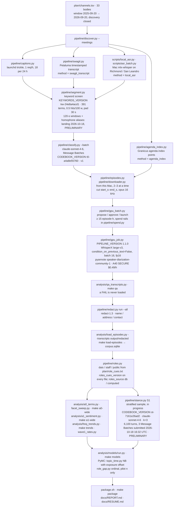
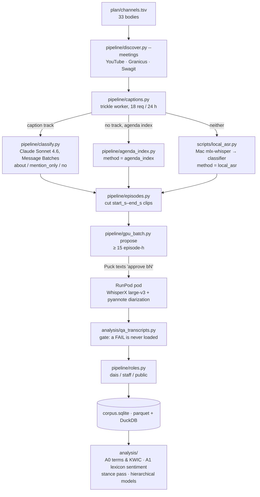

# ytpt — who talks about housing density and transit in Bay Area public meetings

A transcription-and-analysis pipeline for the public record. Over a twelve-month
window (Sep 2025 – Sep 2026) it discovers the recorded meetings of 33 Bay Area
city councils, county boards and transit boards, finds the stretches of each
meeting that are *about* housing density (housing element, upzoning, ADUs,
parking minimums…) or transit (BART, Caltrain, bus and bike lanes, road
diets…), transcribes only those stretches on a rented GPU with speaker
diarization, labels each speaker cluster by role (dais / staff / public comment)
without identifying anyone, and lands the result in a queryable corpus. The
research question (`plan/PROPOSAL-transit.md` §1): how much meeting time goes to
density and transit, who speaks in those episodes — the dais or the public —
and how the stance taken by each side varies across bodies and months. The
inference is about rates, frames, stance and tone as functions of role, body and
time, never about identified individuals (`plan/ANALYSIS-transit.md` §0).

The pipeline and the data are done; **the analysis write-up is in progress**
(exploratory A0/A1 passes are run, the stance pass and the hierarchical models
are not — `plan/SHOWCASE.md` §4).

## Architecture

Two diagrams. **Production pipeline (current phase)** shows only what is
built, running and will be finished in this phase, with the script and the
pinned instrument version on each node. **Research flowchart (all routes,
incl. validation arms)** is the full design, including the alternative locate
routes and the paid passes that are not scheduled; the pending items are on
the docket in [`docs/FUTURE-STEPS.md`](docs/FUTURE-STEPS.md) and every dollar
is traced in [`docs/COSTS.md`](docs/COSTS.md).

### Production pipeline (current phase)



### Research flowchart (all routes, incl. validation arms)



Legend: the production chart has only nodes that exist and run today, each with
its script and instrument version (`CODEBOOK_VERSION`, `KEYWORDS_VERSION`,
`PIPELINE_VERSION`, `redact-1.3`); the research chart also shows the full
stance pass, the A1 Claude pass and the validation arms (`plan/RECALL-CHECK.md`,
`plan/CODEBOOK-V2-PILOT*.md`), none of which is in the current phase. Nodes
marked PRELIMINARY are landing while this was written and need re-checking.

Three locate routes feed the same episode table and are recorded in
`episodes.method`; figures are drawn per route, never pooled
(`analysis/facets.py` refuses). Petaluma adds a fourth, Swagit's own
timestamped transcript (`pipeline/swagit.py`). `state.sqlite` is the only
source of truth for where every meeting and episode is in the state machine
(`plan/SCHEMA.md`).

## Numbers (2026-10-16)

| What | Value | Source |
|---|---|---|
| Bodies in the frame | 33 | `plan/channels.tsv`, `START_HERE.md` |
| Meetings discovered | 635 · 2,168 meeting-h | `dashboard/status.py` digest [^1] |
| Episodes located | 588 (111.7 h) | same |
| Episodes transcribed | 398 · 82.2 audio-h | same; `plan/SHOWCASE.md` §4 row 1b |
| Transcripts through the QA gate | 552 · 456 OK / 96 WARN / **0 FAIL** | same; `output/qa/latest.csv` |
| ASR disagreement vs YouTube captions | 8.7 % pooled (43 pilot episodes) | `docs/TESTING.md` level 4, `output/validation/REPORT.md` |
| Offline checks in `make test` | 415 | `[PASS]` lines, 2026-10-16 [^2] |
| GPU cost, measured | $0.021 per audio-hour all-in | `plan/PROPOSAL-transit.md` §2.2 (b9, b11); `plan/ROADMAP.md` (b17 $0.0211) |

[^1]: `make status` prints the digest from `state.sqlite`; the status file in
    `START_HERE.md` is updated less often and may lag these totals.
[^2]: `make test` prints one `[PASS]` line per check and ends in
    `All checks passed.`; it has grown from 81 (Sep 17) to 415 as each review
    pinned its bugs.

## Operating rules

Every one of these is a code path, not a prompt (`plan/DECISIONS.md`):

- **YouTube is touched only from the laptop**, at most 2–3 downloads at a time,
  and the caption worker makes one request an hour with a hard cap of
  18 per rolling 24 h enforced from a `worker_requests` table. On a bot check
  or HTTP 429 the worker stops, writes a 24 h backoff and tells Puck; nothing
  retries (`plan/T2-PLAN.md` §3h, `docs/OPENCLAW_SETUP.md` §7).
- **Every GPU batch is approved by text.** `gpu_batch.py launch` refuses
  unless the batch row says approved; pods are rented per batch and destroyed
  (`plan/DECISIONS.md` #2, #10).
- **Spend caps in code.** `pipeline/spend.py` keeps a ledger with hard stops:
  `MONTHLY_SPEND_CAP_USD` and `CLAUDE_CAP_USD` in `.env`, a stop line on the
  RunPod prepaid credit, and a `worst_case_usd` rail checked before launch.
- **Agent-supervised operations.** An OpenClaw agent on the Mac watches the
  launchd workers, runs the repo's scripts and reports to Puck on WhatsApp.
  Its hard money gates — never create a pod except through the approved
  launch command, never retry a bot check, never read `.env` — are in
  [`ops/openclaw/AGENTS.md`](ops/openclaw/AGENTS.md); the coding-session rules
  are in [`AGENTS.md`](AGENTS.md) and [`CLAUDE.md`](CLAUDE.md).
- **Privacy.** Speaker labels are anonymous clusters with a role; no names are
  extracted, stored or indexed (`plan/DECISIONS.md` #15).

## Quick start

```bash
./setup.sh              # venv, deps, tool checks (ffmpeg + libopus, deno, SQLite FTS5)
make test               # offline checks on simulated data with a planted effect
make smoke              # the toolchain on this machine, no network, no spend
make dashboard-demo     # the progress page on synthetic data, http://localhost:8765
```

`make` with no target lists everything else. Nothing in the quick start needs
a `.env`, a GPU or a network connection; `docs/TESTING.md` explains each level
and what it proves.

## Dashboard

The dashboard lives in [`docs/`](docs/) and is published by GitHub Pages from
`main:/docs` — `docs/index.html` is the site root, `docs/methods.html` is the
methods and flowchart page, and `docs/.nojekyll` keeps Pages from running the
files through Jekyll. The tool code stays at the top level; `docs/` is both the
Pages root and the written-docs folder.

The pages read JSON from `docs/data/`, which
[`scripts/site_export/`](scripts/site_export/) builds from the corpus:

```bash
cd ~/ytpt
.venv/bin/python scripts/site_export/export_site_data.py   # bodies, meetings, episodes, terms
.venv/bin/python scripts/site_export/export_panels.py      # the analysis panels and their figures
.venv/bin/python scripts/site_export/export_methods.py     # the instruments on the Methods page
.venv/bin/python scripts/site_export/export_flow.py        # the Methods flowchart
.venv/bin/python scripts/site_export/export_nimby_points.py

python3 -m http.server 8788 --directory docs                # then check it
.venv/bin/python scripts/site_export/verify_site.py http://localhost:8788
```

Only the files the two pages actually fetch are committed (~9.5 MB);
`docs/.gitignore` lists what is deliberately left out and why. The biggest
omission is `docs/data/episodes/` — 19 MB of full meeting turns that the
episode reader fetches on demand — so on the published site the reader opens
with its text pane empty.

## Repo map

| Path | What |
|---|---|
| `pipeline/` | the laptop workers: discover, captions, classify, agenda index, episodes, transcode, GPU batch gate, pod job, spend ledger, roles |
| `analysis/` | QA gate, loaders, word frequency / KWIC / keyness, A0 and A1 passes, `test_pipeline.py` |
| `dashboard/` | local progress page and the WhatsApp status digest |
| `scripts/` | one-shot tools: smoke test, credential checks, Mac ASR, classifier validation, audits |
| `ops/` | launchd plists for the workers; the OpenClaw supervisor's config, approvals and runbooks |
| `plan/` | the specification: proposal, decisions, schema, sampling, T0/T2 plans and results |
| `docs/` | **the published dashboard** (`index.html`, `methods.html`, `site.css`, `data/`) plus the written docs: testing ladder, model choices, supervisor setup, handoff reviews |
| `scripts/site_export/` | builds `docs/data/` from the corpus, and the headless checks that gate a site commit |
| `legacy/` | the frozen Hasan/Tucker side-corpus one-offs (`plan/DECISIONS.md` #16) |
| `output/`, `state.sqlite` | audio, transcripts and state — gitignored, never committed |

Start with [`START_HERE.md`](START_HERE.md) (current state, the mistakes that
cost money), then `plan/README.md` → `plan/DECISIONS.md` →
`plan/PROPOSAL-transit.md`; the statistics are in
[`analysis/METHODS.md`](analysis/METHODS.md); the showcase plan is
`plan/SHOWCASE.md`.

## What broke, and what we did

- **YouTube rate-limited the caption fetch twice.** The first run 429'd after
  17 requests in 31 min, the second after 5 in 41 min. The fix was not a
  faster retry but a slower worker: a launchd trickle at one meeting an hour,
  capped at 18 requests per rolling 24 h from a table written *before* each
  call so a restart cannot burst, with the queue ordered by measured episode
  yield per body instead of by date (`plan/T2-PLAN.md` §3a, §3h).
- **Two Granicus bodies looked caption-less and were not.** Santa Clara and
  Hayward serve a full English track through a Flowplayer config with no
  `<track>` element, the only thing the parser read. Fixing the parser and
  refetching recovered 37 meetings — Santa Clara 34 of 40, 178 meeting-hours —
  that had been written off (`plan/T2-PLAN.md` §3d, `plan/sources_bayarea.md`).
- **Haiku 4.5 was tested as the classifier and rejected.** Against the Sonnet
  labels on 198 T0 windows it agreed 0.758 on about-vs-not and demoted a third
  of the transit episodes, nearly all BART board items. The decision rule
  written before the test said Sonnet 4.6 via the Batches API
  (`plan/T2-PLAN.md` §2, `docs/MODELS.md`, `plan/DECISIONS.md` #17).
- **VADER saturates with turn length.** The compound score is a normalised
  sum over matched lexicon words, so turns of 250+ words score |0.9|+ 84 % of
  the time and 1–5-word turns score exactly 0 73 % of the time. "Public comment
  is more positive than the dais" reversed once length was controlled; the
  lexicon pass is reported as a length-aware appendix, not a result
  (`plan/A1-RESULTS.md`).
- **A QA-gate bug is open, on purpose.** `qa_transcripts.py` windows an
  episode's caption reference by a field that is 0 in 28 of 29 transcripts of
  one batch, which produced two absurd disagreement rates; the evidence and
  the $0 fix are written up and waiting for a decision
  (`plan/BART-QIL-ASSESSMENT.md`, `plan/SHOWCASE.md` §4 row 3).

## License

MIT — see [`LICENSE`](LICENSE).
