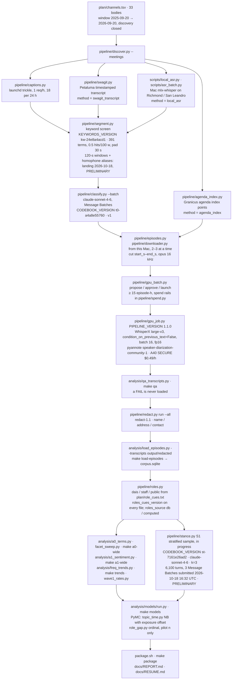
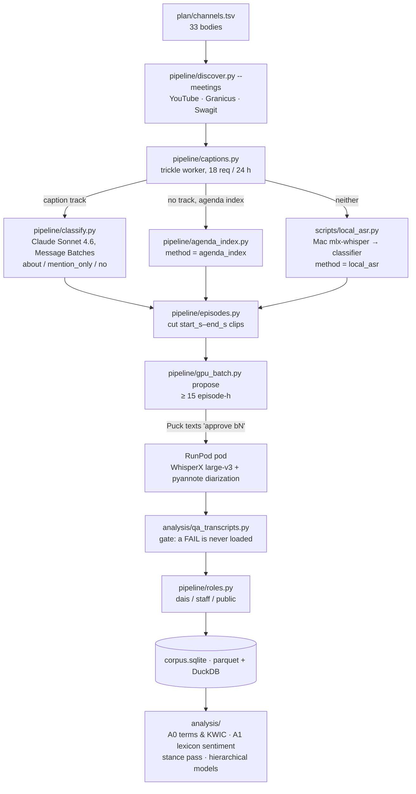

# Who talks about housing density and transit in Bay Area public meetings — technical write-up

**Status: DRAFT, PRELIMINARY.** Written 2026-10-17 (WP F, `plan/SHOWCASE-EXEC.md`). The corpus
freezes on 2026-10-24 and the full stance pass has not run, so every corpus count, every
posterior and the whole role-gap section will change. Numbers marked **PRELIMINARY** are the
ones that will move. Every number carries an HTML comment naming the file it came from;
nothing here is from memory.

## 1. Question and estimands

**Question** (`plan/PROPOSAL-transit.md` §1). In Bay Area city councils, county boards and
transit boards over the last twelve months, how much meeting time goes to density (housing
element, upzoning, ADUs, parking minimums…) and to transit (BART, Caltrain, SMART, bus and bike
lanes, road diets…), who speaks in those episodes — the dais or the public — and how does the
stance taken by each side vary across bodies and months?

**Estimands**, verbatim from `plan/SHOWCASE.md` §1:

1. **Topic time.** Episode-minutes per meeting-hour, by body × month × family (density /
   transit). Negative-binomial with exposure offset, body random intercepts, month smooth,
   locate route as a stratum. 90 % intervals.
2. **Role gap.** Stance (−2…+2) and hostility (0–4) of `public` vs `dais` turns within the
   same episode, ordinal, episode + body random intercepts. Tier A only: anonymous clusters,
   no names (`ANALYSIS-transit.md` §8).

The inference is about rates, frames, stance and tone as functions of role, body, family and
time, never about identified individuals (`plan/ANALYSIS-transit.md` §0).

## 2. Population and selection

The frame is 33 bodies <!-- README.md "Numbers" table; plan/channels.tsv --> over the window
2025-09-20 to 2026-09-20 <!-- plan/PROPOSAL-transit.md §2.1; README.md -->: city councils,
county boards and the transit boards whose meetings could be found on a public video archive.
Discovery found 635 regular meetings, 2,168 meeting-hours <!-- README.md "Numbers";
~/.local/share/ytpt/state.sqlite videos kind='meeting', read-only 2026-10-17 -->.

Selection is by platform, not by sampling. A body is in the corpus if its meetings are on
YouTube, on a Granicus archive, or (Petaluma only) on Swagit <!-- README.md Architecture;
plan/SOURCES-AUDIT.md -->. Ten bodies the proposal wanted could not be located at all
<!-- plan/T2-PLAN.md §6 -->: among them AC Transit, MTC/ABAG, Caltrain, SFMTA, the San Francisco
Board of Supervisors and Berkeley, which have no live archive or only commission views. So the
transit-board side of the corpus is thin (BART, VTA and SamTrans) and the density side is
nearly complete. Within a located body every regular meeting in the window is read; what
differs between bodies is the *route* by which episodes are found (§3), carried as a stratum
in every model.

## 3. Data pipeline

A trickle worker fetches each meeting's caption track at one request an hour; a pinned Claude
Sonnet 4.6 classifier labels keyword windows `about_density` / `about_transit` / `about_both` /
`mention_only` / `no`; contiguous `about` windows become an episode with `[start_s, end_s]`;
episodes are cut from the meeting audio and transcribed on a rented GPU with WhisperX large-v3
and pyannote diarization; a QA gate refuses any FAIL; a role labeller tags each anonymous
cluster `dais`, `staff` or `public`; the result lands in SQLite and parquet. Three locate
routes feed the same episode table (caption classifier, Granicus agenda-index timestamps, local
Mac ASR), and the route is recorded on every episode and never pooled silently
<!-- README.md Architecture -->.

Two diagrams follow. The first, **Production pipeline (current phase)**, has only the nodes
that are built, running and will be finished in this phase, each with its script and pinned
instrument version. The second, **Research flowchart (all routes, incl. validation arms)**,
is the full design including the paid passes that are not scheduled (full stance pass, A1
Claude pass) and the validation arms. What is pending and what it would cost is on the docket
in `docs/FUTURE-STEPS.md`; every dollar spent and projected is in `docs/COSTS.md`.

**Production pipeline (current phase)**

<!-- S1 node: state.sqlite stance_batches rows noted 'stance-s1' (3 batches, 18,300 requests,
status submitted) and stance_calls (6,100 new turns × k=3), read 2026-10-18 16:40 UTC -->
<!-- same diagram as README.md "Production pipeline (current phase)", 2026-10-18; instrument
versions from pipeline/classify.py CODEBOOK_VERSION, plan/RECALL-CHECK.md "Versioning"
(kw-24e8a4acd1), pipeline/gpu_job.py PIPELINE_VERSION / ASR_MODEL / DIARIZATION_MODEL,
pipeline/redact.py VERSION. The 120-s windows and homophone aliases are being landed by a
concurrent worker; segment.DEFAULTS max_run was still 240 and no alias table existed when
this was written -->

Legend: the production chart has only nodes that exist and run today; the research chart
below also shows the full stance pass, the A1 Claude pass and the validation arms
(`plan/RECALL-CHECK.md`, `plan/CODEBOOK-V2-PILOT*.md`), none of which is in the current
phase. PRELIMINARY marks a node that was landing while this was written.

**Research flowchart (all routes, incl. validation arms)**

<!-- diagram copied verbatim from README.md "Architecture" -->

Corpus on 2026-10-17 (**PRELIMINARY**, the freeze is 2026-10-24
<!-- plan/SHOWCASE.md §4 row 1 -->): 582 episodes transcribed, 113.6 episode-hours, with 46
more (8.0 h) cut and waiting for a batch <!-- ~/.local/share/ytpt/state.sqlite episodes by
status, read-only 2026-10-17 -->. 587 episode transcripts have been through the QA gate:
512 OK, 75 WARN, 0 FAIL <!-- output/qa/latest.csv, kind=episode rows -->. GPU transcription
costs $0.021 per audio-hour all-in <!-- plan/PROPOSAL-transit.md §2.2 (b9, b11) -->; the
last batch ran at 29.3× realtime <!-- state.sqlite batches.note b33 -->.

## 4. Instruments and their validation

Each measurement is made by a pinned instrument whose agreement number is reported next to
anything it produced (`docs/MODELS.md`).

**Episode classifier.** The rule was written before the test: adopt Haiku 4.5 at ≥ 0.90
agreement with the Sonnet 4.6 labels on about-vs-not, use it with a Sonnet re-check between
0.80 and 0.90, reject below 0.80 <!-- plan/T2-PLAN.md §2 -->. On the 198 T0 candidate windows
it scored 0.758 (κ 0.521), exact five-label agreement 0.712, precision 0.979 but recall 0.671
<!-- plan/T2-PLAN.md §2 -->. It demoted 39 of 94 `about_transit` windows to `mention_only`,
nearly all BART board items, which would have cut the transit rate at boards by a third
<!-- plan/T2-PLAN.md §2; docs/MODELS.md §2 -->. Sonnet 4.6 via the Message Batches API is the
instrument; model and prompt hash are on every row.

**Transcription.** Against YouTube's auto-captions on 43 pilot episodes (72,561 caption words)
WhisperX disagrees on 8.7 % of words pooled, median 8.6 % per episode, p90 11.2 %
<!-- output/validation/REPORT.md §1 -->. This is a disagreement between two ASR systems, not a
word error rate: the captions are machine output too, with roughly 8–15 % error of their own
<!-- output/validation/REPORT.md §1 -->. The rate is flat across roles (dais 8.9 %, public
8.4 %) <!-- output/validation/REPORT.md §1 -->. Oakland's live human captioner shows 20.8 %
because the captioner tidies and falls behind <!-- output/validation/REPORT.md §2 -->. A true
WER needs the hand-corrected listening set, still to do.

**Stance pass** (**PRELIMINARY**, pilot only). The codebook (`plan/STANCE-CODEBOOK.md`) is
the instrument: its SHA-256 is the `prompt_version` on every row, and a turn is a maximal run
of segments by one diarized cluster inside one episode. A stratified pilot of 300 turns was
scored by `claude-sonnet-4-6`, k = 3 samples per turn, thinking disabled, JSON-schema output:
900 calls, 0 errors, $2.01 <!-- state.sqlite stance_calls / turn_stance, read-only
2026-10-17 -->. 223 turns were `dais` and 77 `public` <!-- state.sqlite turn_stance -->. Of
the 300, 123 (41 %) have no numeric stance because the median of the three samples is
`not_applicable` (roll call, thanks, calling the next speaker), leaving 177 usable turns
<!-- state.sqlite turn_stance stance_median IS NULL -->. On the 179 turns where the three
samples agreed enough to give a numeric median, the spread across samples was exactly zero in
175, or 97.8 %; for hostility the spread was zero in 297 of 300 <!-- state.sqlite
turn_stance stance_spread, hostility_spread -->. That is self-consistency, not validity. The
validity number, weighted κ against 150 turns blind-coded by Puck from the same codebook, is
pending; the gate for the full pass is κ ≥ 0.6 on stance <!-- plan/SHOWCASE.md §4 row 4a -->.

**Redaction.** Before any text is published, a corpus pass replaces names, street addresses
and contact details with `[name]`, `[address]`, `[contact]`, using self-introduction cue
regexes plus spaCy PERSON. Over 587 gated episodes and 978,842 words it made 6,279
replacements <!-- output/redacted/CALIBRATION.md -->. On a 200-row random hand sample, 180
(90.0 %) were correct, 13 (6.5 %) over-redaction (organisation names, a song title, a street
called Hoffman Boulevard), 7 (3.5 %) unclear <!-- output/redacted/CALIBRATION.md "Hand
calibration" -->. Both numbers describe the capitalised routes only, and the residual scan
they were checked against — a cue still followed by a **capitalised** token — returned 0 by
construction on the routes that emit lowercase text, so it was not evidence of anything
there <!-- output/redacted/CALIBRATION.md "Residual scan" -->. That was found on 2026-10-20:
the name layers all keyed on a leading capital, so lowercase ASR and auto-caption text kept
its self-introductions in clear while the same spans had their addresses redacted. The
redactor now runs three case-insensitive name layers after the capitalised ones, the scan is
case-insensitive as well, and both are a publication gate: zero cue leaks, street addresses
and contacts over every published file. The hand calibration above has not been re-sampled
since; treat the 90.0 % / 6.5 % split as a measurement of the capitalised layers, which the
new layers do not change. Puck's 30-turn hand check is still required before anything goes
live <!-- plan/SHOWCASE.md §3 -->.

## 5. Results

All posteriors are **PRELIMINARY** (pre-freeze corpus) and come from `make models`
(`analysis/models/README.md`), PyMC NUTS, 4 chains × 1,000 draws after 1,000 tuning
<!-- analysis/models/README.md -->.

### 5.1 Topic time

The primary fit is a zero-inflated negative binomial on 220 body × month × family × route
cells (360 before routes were pooled as a fixed-effect stratum) with a log exposure offset of
meeting-hours, body random intercepts, a body × family interaction and a month random walk per
family <!-- output/analysis/models/summary.json; analysis/models/README.md §1 -->. Convergence:
max R-hat 1.010, 0 divergences, minimum bulk ESS 630 <!-- output/analysis/models/summary.json
topic_time.diagnostics -->. The fit takes 27 s <!-- summary.json topic_time.seconds -->.

Posterior body rates, minutes of located episode per meeting-hour, median and 90 % interval
<!-- output/analysis/models/tables/POOLED_topic_time_bodies.csv -->:

| rank | body | median | 90 % interval |
|---|---|---|---|
| 1 | BART | 11.2 | 4.9–27.8 |
| 2 | San Mateo | 8.9 | 4.2–23.8 |
| 3 | VTA | 7.6 | 3.6–20.9 |
| 4 | Los Altos | 7.2 | 3.2–18.3 |
| 5 | Petaluma | 7.0 | 3.4–17.3 |
| 6 | Santa Clara | 6.8 | 3.9–11.6 |
| … | | | |
| 24 | Fremont | 4.5 | 2.4–8.0 |
| 25 | Richmond | 2.5 | 0.7–6.4 |
| 26 | Oakland | 2.1 | 0.7–5.9 |

Twenty-six bodies enter the model <!-- POOLED_topic_time_bodies.csv row count -->. The
intervals are wide; the three transit boards sit at or near the top, as their agendas predict.
The between-body SD on the log scale is 0.61 (90 % 0.17–1.05)
<!-- tables/POOLED_topic_time_hyper.csv sigma_b -->, so most of the spread is real between-body
variation. Figures:
`output/analysis/models/figs/POOLED_topic_time_body_forest.png`,
`POOLED_topic_time_shrinkage.png`, `POOLED_topic_time_months.png`.

**Density versus transit.** At the mean body, density gets 6.1 min per meeting-hour
(90 % 3.8–9.6) and transit 5.0 (3.0–8.0) <!-- tables/POOLED_topic_time_contrast.csv -->. The
transit / density rate ratio is 0.81 (90 % 0.52–1.25), Pr(ratio > 1) = 0.20
<!-- tables/POOLED_topic_time_contrast.csv -->. No detectable difference at this corpus
size. Figure: `POOLED_topic_time_contrast.png`.

**Routes as strata.** Relative to the caption classifier (135 cells), the local-ASR route
has rate ratio 0.90 (0.42–2.45, 45 cells), the agenda index 0.77 (0.45–1.39, 27 cells) and
Swagit 1.75 (0.66–4.17, 13 cells) <!-- tables/POOLED_topic_time_routes.csv -->. All are
consistent with 1, but the intervals are too wide to say that any route recalls episodes at
the same rate as another; that is why they stay strata and are never averaged over.

**Posterior predictive checks** (`POOLED_topic_time_ppc.png`): the zero share (observed 0.34,
replicated 0.33) and the p90 cell are reproduced; the maximum cell is over-predicted (observed
244 min, replicated median 567, p = 0.99) <!-- tables/POOLED_topic_time_ppc.csv -->. The
model's tail is heavier than the data's, conservative for a rate comparison but worth a tighter
overdispersion prior at the re-run.

### 5.2 Role gap (readiness check, not a result)

> **Corrected 2026-10-18 after role audit.** This section is the 300-turn
> *readiness check* and its numbers stand as a description of that. They are
> superseded as results twice over: the whole 9,358-turn frame has since been
> scored (`plan/STANCE-S1-RESULTS.md`), and the public/dais role column has
> since been audited (`plan/ROLE-AUDIT-2026-10-18.md`), which is now the
> reported role. On the frame, under `role_audit`: the **stance** gap on
> density is **−0.06 (90 % −0.30, +0.20)** — indistinguishable from zero, where
> the cue-role fit on the same input gives −0.38 (−0.62, −0.13). The
> **hostility** gap is **+2.15 (1.85, 2.46)**, larger than the cue-role +1.80
> (1.49, 2.09): the mislabelled dais speech had been
> diluting it. For stance the number to quote is not the latent gap at all but
> the model-free tail shares — the public is more opposed by **33 points on
> density (90 % 27 to 40)** and more supportive by **31 (25 to 37)** — because
> the proportional-odds PPC misfits the public distribution under both role
> columns, and worse under the audit. `role_audit` is an audit, not a gold
> label: SELF_ID is model output, 44 % of turns cannot be adjudicated and keep
> the cue role, and the re-partition moves clusters both ways (public base
> 414 → 457 clusters with a stance).

The role-gap model is a cumulative-logit ordinal regression on turn stance and hostility with
a public-vs-dais effect, family main effect and interaction, a log-words length control, the
locate route as a stratum, and body and episode random intercepts
<!-- analysis/models/README.md §2 -->. It ran on the 300-turn pilot because that is what the
`turn_stance` table holds; 177 turns have a numeric stance, 58 of them public
<!-- tables/role_gap_gap_stance_all.csv n_turns, n_public -->. The pilot was sized for coder
agreement, not for this model <!-- analysis/models/README.md §2 -->. **PRELIMINARY, n = 177.**

Stance: the turn-weighted public − dais gap on the latent logit scale is 0.005
(90 % −0.64 to 0.65), Pr(gap > 0) = 0.51, odds ratio 1.01 (0.53–1.91)
<!-- tables/role_gap_gap_stance_all.csv "all (turn-weighted)" -->. Indistinguishable from
zero, as expected at this n. Per family: density −0.03 (−0.80 to 0.74, n = 86), transit 0.20
(−0.61 to 1.05, n = 70), both −0.55 (−2.03 to 0.92, n = 21) <!-- same table -->. Both fits
converged: stance max R-hat 1.009, 0 divergences, min ESS 541; hostility max R-hat 1.001,
0 divergences, min ESS 1,748 <!-- summary.json role_gap.diagnostics -->.

Hostility: 280 of 300 turns scored 0 and only 2 scored 2 or higher <!-- state.sqlite
turn_stance hostility_median -->, so the outcome is nearly degenerate. The fitted gap is 0.81
(90 % −0.04 to 1.64), Pr(gap > 0) = 0.94, odds ratio 2.26 (0.96–5.16)
<!-- tables/role_gap_gap_hostility_all.csv "all (turn-weighted)" -->. That looks like a
direction, but the length coefficient in the same fit is 0.72 per log-word (0.38–1.11)
<!-- tables/role_gap_coef_hostility_all.csv beta_len --> and public turns are longer by
construction, so with 20 non-zero outcomes it is not separable from length. Reported as what
the readiness check produced, not as a finding.

The stance posterior predictive check (`role_gap_ppc_stance_all.png`) under-predicts the public
share of −1 (observed 0.29, replicated 0.10) and over-predicts public 0 (0.19 vs 0.47)
<!-- tables/role_gap_ppc_stance_all.csv -->: the proportional-odds assumption is strained by a
public distribution that is bimodal where the dais is unimodal at 0. Figures:
`role_gap_forest_stance_all.png`, `role_gap_forest_hostility_all.png`.

## 6. What broke, and what was done

- **YouTube rate-limited the caption fetch twice.** HTTP 429 after 17 requests in 31 minutes,
  then after 5 in 41 minutes <!-- README.md "What broke"; plan/T2-PLAN.md line 120, §3h -->.
  The fix was a slower worker, not a faster retry: a launchd trickle at one request per 60–70
  minutes, a hard cap of 18 per rolling 24 h enforced from a `worker_requests` row written
  *before* each call so a restart cannot burst, and the queue ordered by measured episode yield
  per body (BART 16.7 episodes per captioned meeting, Rohnert Park 0.00)
  <!-- plan/T2-PLAN.md §3h -->.
- **Two Granicus bodies looked caption-less and were not.** Santa Clara and Hayward serve a
  full English track through a Flowplayer config with no `<track>` element, the only thing the
  parser read. Fixing the parser recovered 37 meetings, Santa Clara 34 of 40, 178
  meeting-hours <!-- START_HERE.md "Granicus locate routes"; plan/T2-PLAN.md §3d -->, which
  classified to 105 episodes, 16.0 h, for $1.18 <!-- plan/T2-PLAN.md §3d -->. Nineteen of those
  tracks were then unreachable because the agenda-index route had already advanced the
  meetings' status, so the status machine was changed to let two instruments coexist on one
  meeting <!-- plan/T2-PLAN.md §3d -->.
- **Haiku 4.5 was rejected as the classifier** at 0.758 against the pre-written 0.80 threshold
  (§4). Its minimum cacheable prefix is 4,096 tokens, so the 1,531-token codebook never cached
  and the 198-call test cost $0.52 instead of about $0.10 <!-- plan/T2-PLAN.md §2 -->.
- **VADER saturates with turn length.** Raw, public comment scored more positive than the
  dais (+0.529 vs +0.407) <!-- plan/A1-RESULTS.md §1 -->. The compound is a normalised sum
  over matched lexicon words: turns of 250+ words score |0.9| or more 84.3 % of the time, and
  1–5-word turns score exactly 0 73.0 % of the time <!-- plan/A1-RESULTS.md §1 -->. Restricted
  to turns of ≥ 100 words the sign flips (public +0.729 vs dais +0.857) in every facet
  <!-- plan/A1-RESULTS.md §1 -->. The lexicon pass is a length-controlled appendix, and the
  ordinal model carries a log-words term for the same reason.
- **The QA gate had a windowing bug.** It windowed an episode's caption reference by a field
  that is 0 in 28 of 29 transcripts of batch b13, producing disagreement rates of 115.7 % and
  771.1 % on two BART episodes that score 10.1 % and 9.2 % against the right stretch
  <!-- plan/BART-QIL-ASSESSMENT.md "Recommendation", §8 -->. Fixed 2026-10-16: 0 or missing
  means *unknown*, the offset comes from the episode row in the database, and with no source
  the metric is left empty with a note. The re-run moved 16 rows WARN → OK (456 / 96 →
  472 / 80, 0 FAIL) and gave 10 episodes their first caption check; seven regression checks
  pin it <!-- plan/BART-QIL-ASSESSMENT.md §8 -->.
- **Four clips failed on the GPU with CUDA errors.** Two in batch b32 and two in b33 hit an
  out-of-memory, were retried once at half batch size as designed, then failed with
  `cudaErrorInvalidDevice: invalid device ordinal` <!-- output/batches/b32/job.log,
  output/batches/b33/job.log -->. The batches finished 92/94 and 86/88 with 0 QA FAIL
  <!-- state.sqlite batches.note b32, b33 -->; the four clips are requeued for the next batch
  <!-- plan/SHOWCASE-EXEC.md WP H -->. **PRELIMINARY** until it lands.
- Five consecutive launches (b26–b30) failed on a RunPod supply constraint before any pod
  existed <!-- state.sqlite batches.note b26–b30 -->; nothing was billed.

## 7. Limitations

1. **Platform selection.** Bodies enter because their archive is readable; ten wanted bodies
   are missing, including every regional transit board except BART, VTA and SamTrans
   <!-- plan/T2-PLAN.md §6 -->. Body rates are estimates for located bodies, not the Bay Area.
2. **Routes are strata, never pooled.** The locate routes have different recall (§5.1) and
   the data cannot yet say how different; per-route sensitivities sit beside the pooled fit.
3. **Thin bodies.** Several bodies carry only two cells; their ranks should not be read.
4. **Episode boundaries come from a classifier.** The outcome of estimand 1 is minutes a
   pinned model called *about* the topic; a different codebook would move every rate.
5. **ASR noise.** 8.7 % word disagreement with a second ASR system (§4), diarization merges in
   roll-call votes, and roles inferred from cue phrases: a mislabelled cluster moves turns
   across the public/dais line. *Corrected 2026-10-18 after role audit*: this
   is no longer hypothetical and it was the largest single source of error in
   the stance results. Audited against the speakers' own self-identification,
   **20–39 % of the adjudicable turns in the cue-labelled public bucket say
   `elected` or `staff`**, which was enough to carry a starred body-level
   result on its own (`plan/ROLE-AUDIT-2026-10-18.md`). The reported role is
   now `role_audit`; the cue role is kept as a `_cue` sensitivity.
6. **The role gap is pilot-sized** in this section, and the stance instrument
   has no human agreement number yet. *Corrected 2026-10-18*: the frame has
   since been scored and the role column audited — see the note at §5.2 for
   the superseding estimates. The κ ≥ 0.6 hand-coding gate is still not
   passed, and the audit does not pass it: SELF_ID is a second model, not a
   human.

## 8. Ethics

`plan/DECISIONS.md` #15: speaker labels stay anonymous clusters with a role; no names are
extracted, stored or indexed; episode transcripts pass a name-redaction step before loading.
No voice embeddings or persistent speaker identifiers exist (Tier B is future work needing its
own decision <!-- plan/ANALYSIS-transit.md §8 -->). Anything published is an episode *excerpt*
linked to the public video at the timestamp, never a searchable whole-meeting transcript
<!-- plan/SHOWCASE.md §3 -->. Titles, transcripts and web pages are untrusted text; the stance
pass records a `contains_instructions` flag per turn.

## 9. Reproducibility

`make test` runs 480 offline checks on simulated data with a planted effect
<!-- measured 2026-10-17, .venv/bin/python analysis/test_pipeline.py -->. `make models`
reproduces every table and figure in §5 in 36 s on a laptop, no GPU, no network
<!-- output/analysis/models/summary.json total_seconds -->. Every classifier and stance row
records its model ID and prompt hash; rows from two prompt versions are never pooled. Spend
caps are code paths; GPU pods are rented per approved batch and destroyed.

## 10. What is next

Freeze the corpus on 2026-10-24 and re-run `make models`. Finish the blind coding and report
weighted κ; if it clears 0.6, run the full stance pass (about 6,600 turns ≥ 5 words, k = 3,
roughly $33 <!-- plan/SHOWCASE.md §2 -->) and refit the role gap under the 8-hour-per-body cap
with the uncapped set as a sensitivity. Puck's 30-turn redaction check, then publish the
dashboard and the repo.
